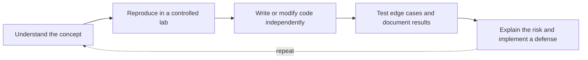

<!-- ═══════════════════════════ HEADER ═══════════════════════════ -->
<div align="center">


<a href="https://github.com/bibeksec/bibeksec">
  
</a>

<br/>

[](https://bibeksec.github.io)
[](https://youtube.com/@BibekSec)
[](https://tryhackme.com/p/bibektamata012)


</div>

---

## 🧬 Identity

```text
$ whoami
bibek_tamata

$ cat profile.txt
role        : BIT student · Cybersecurity learner · Builder
location    : Nepal 🇳🇵
interests   : SOC analysis · Web security · Python automation · Responsible OSINT
long_term   : Skilled security professional, strong in offense AND defense
philosophy  : Understand the fundamentals. Write my own code. Test it. Document it.
```

I'm **Bibek Tamata**, building practical skills in cybersecurity, Python, Linux, networking, and software development. I believe in understanding the fundamentals, writing my own code, testing what I build, and documenting what I learn.

<div align="center">

```text
┌─────────────────────────────────────────────────────────┐
│  BIBEKSEC :: SECURITY RESEARCH & DEVELOPMENT            │
│                                                         │
│   [ LEARN ] ──▶ [ BUILD ] ──▶ [ TEST ] ──▶ [ SECURE ]  │
│                                                         │
│   Focus       : Cybersecurity | Python | Linux          │
│   Environment : Linux Mint | Terminal | Security Labs   │
│   Philosophy  : Fundamentals first. Evidence always.    │
└─────────────────────────────────────────────────────────┘
```

</div>

---

## 🚀 Featured Projects

<table>
<tr>
<td width="50%" valign="top">

### 🛡️ Sentinel Detect


Hands-on security monitoring: authentication-log analysis and suspicious-login detection.

- Detects suspicious authentication patterns
- Generates alerts with severity and investigation context
- Explores **MITRE ATT&CK** mapping
- Practices detection logic with synthetic events

**[→ Explore Repository](https://github.com/bibeksec/sentinel-detect)**

</td>
<td width="50%" valign="top">

### 🔍 Nepal ScamWatch


Scam awareness and reporting, making cybersecurity information more accessible in Nepal.

- Searchable scam reports and case tracking
- Secure handling of submitted information
- Moderation, validation, and abuse prevention
- Practical web-application security skills

**[→ Explore Repository](https://github.com/bibeksec/nepal-scamwatch)**

</td>
</tr>
<tr>
<td width="50%" valign="top">

### 🌐 GOD-EYE Nepal


An open-source intelligence dashboard concept using public data and geographic visualization.

- Works with external data sources
- Geographic and situational visualization
- Responsible intelligence research
- Source reliability, privacy, and data quality

**[→ Explore Repository](https://github.com/bibeksec/god-eye-nepal)**

</td>
<td width="50%" valign="top">

### 💻 BibekSec Portfolio


My personal hub for technical projects, security experiments, learning progress, and future research.

- Projects and write-ups in one place
- Learning progress, documented publicly
- Home for future research

**[→ Visit Portfolio](https://bibeksec.github.io)**

</td>
</tr>
</table>

---

## 🧰 Technical Arsenal

<div align="center">

| Category | Tools |
|:--|:--|
| **Programming** |    |
| **Systems & Networking** |   |
| **Web & Frontend** |   |
| **Collaboration** |   |


<sub>*My toolkit reflects hands-on practice and ongoing learning, not a claim of mastery in every technology.*</sub>

</div>

---

## 📡 Current Operations

| Status | Mission |
|:--:|:--|
| 🟢 | Strengthening Python fundamentals and problem-solving |
| 🟢 | Developing Python utilities for security analysis |
| 🟢 | Practicing Linux administration and command-line workflows |
| 🟡 | Learning networking, traffic analysis, and system security |
| 🟡 | Studying web vulnerabilities in **authorized** practice labs |
| 🟡 | Building foundations in SOC analysis and incident investigation |
| 🟢 | Improving documentation, testing, and secure coding |

<sub>🟢 active practice · 🟡 learning in progress</sub>

---

## 🧠 Learning in Public

A strong security engineer should understand **why** a vulnerability exists, **how** it can be verified safely, **how** it can be detected, and **how** it can be prevented.



```python
class BibekSec:
    mission = "Learn. Build. Secure."

    principles = [
        "Understand before automating",
        "Practice before claiming expertise",
        "Test before trusting",
        "Document before publishing",
        "Respect authorization and privacy",
    ]

    def next_step(self):
        return "Learn something. Build something. Prove it."
```

---

## 📊 GitHub Stats

<div align="center">


</div>

---

## 🎯 Security Labs & Community

<div align="center">

[](https://tryhackme.com/p/bibektamata012)
[](https://app.hackthebox.com/)
[](https://portswigger.net/web-security)
[](https://leetcode.com/)
[](https://youtube.com/@BibekSec)
[](https://bibeksec.github.io)

</div>

---

## 🤝 Collaboration

I'm interested in:

- 🔓 Meaningful **open-source** contributions
- 🛡️ **Defensive security** tools
- 🐍 **Python automation**
- 🌍 **Responsible OSINT**
- 🎓 Practical **cybersecurity education**

If you're building something useful in security, or want to exchange ideas and knowledge, let's connect through GitHub.

<div align="center">

<br/>

**CURIOUS BY NATURE. DISCIPLINED BY PRACTICE.**

`LEARN` · `BUILD` · `SECURE`

*Building skills. Writing code. Earning trust.*


</div>
