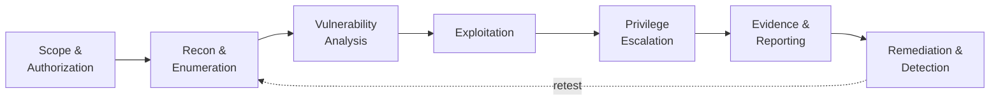

<div align="center">


<br/>

[](https://www.linkedin.com/in/bibek-tamata-2b1808446/)
[](https://bibeksec.github.io/bibeksec.github.io./)
[](https://youtube.com/@BibekSec)

[](https://tryhackme.com/p/bibektamata012)
[](https://app.hackthebox.com/users/3290646)
[](https://portswigger.net/web-security)
[](https://leetcode.com/u/NwLnFoZCvI/)


</div>

<br/>

<div align="center">


</div>

---

## 🧬 Who I Am

I'm **Bibek Tamata**, a penetration tester and BIT student from Nepal.

Most people learn offense *or* defense. I work on both sides of the same problem: I practice attacks in authorized labs, then build tools that **detect those exact attacks.** An attack I can't detect is half-understood, and a detection I can't test is just a guess.

<div align="center">

</div>

---

## ✅ Proof of Work

Claims are cheap, so here is the evidence:

| I say… | Evidence |
|:--|:--|
| I write detections | **10 rules** mapped to MITRE ATT&CK in [Sentinel Detect](https://github.com/bibeksec/sentinel-detect) |
| I test my work | Sentinel ships with built-in self-tests: `python3 sentinel.py selftest` |
| I ship real things | [Nepal ScamWatch](https://nepal-scamwatch.bibektamata012.workers.dev/) is **live** on Cloudflare Workers + D1 + R2 |
| I build responsibly | [GOD'S-EYE](https://github.com/bibeksec/god-eye) labels simulated data and states it does no surveillance of people |
| I document | Every featured project ships a README with setup and run steps |

---

## 🛡️ Flagship Project: Sentinel Detect

> **A Python threat-detection engine that reads SSH and web-server logs and tells you who attacked, how, how serious it is, and which MITRE ATT&CK technique it matches.**


<div align="center">

</div>

| Capability | Detail |
|:--|:--|
| 🧠 **Detection logic** | Stateful sliding windows · threshold detection · event correlation |
| 🎯 **Rules** | Brute force · password spraying · login-after-brute-force · root login · scanners · SQLi · XSS · path traversal · command injection/webshell probes |
| 🗺️ **Threat-informed** | Every rule mapped to a MITRE ATT&CK technique |
| 📊 **Output** | Terminal · JSON · HTML reports · firewall-block suggestions |
| ⚙️ **Operations** | Follow mode for live logs · allowlisting · alert cooldowns · custom rules |
| ✅ **Quality** | Built-in self-tests · synthetic attack demo · zero required dependencies |

```bash
git clone https://github.com/bibeksec/sentinel-detect.git && cd sentinel-detect
python3 sentinel.py --demo        # watch it catch synthetic attacks
python3 sentinel.py selftest      # verify the detections
```

<details>
<summary><b>🗺️ ATT&CK coverage map (click to expand)</b></summary>

<br/>

| Tactic | Technique | Sentinel rules |
|:--|:--|:--|
| 🔍 Reconnaissance | T1595.002 / T1595.003 · Active Scanning | `WEB-001` `WEB-004` |
| 🚪 Initial Access | T1190 · Exploit Public-Facing Application | `WEB-002` `WEB-003` `WEB-005` `WEB-006` |
| ⚡ Execution | T1059 · Command & Scripting Interpreter | `WEB-006` |
| 🔑 Credential Access | T1110.001 / T1110.003 · Brute Force / Password Spraying | `SSH-001` `SSH-002` |
| 👤 Valid Accounts | T1078 / T1078.003 · Valid & Local Accounts | `SSH-003` `SSH-004` |
| 🗂️ Discovery | T1083 · File & Directory Discovery | `WEB-003` |

</details>

**[→ View Sentinel Detect on GitHub](https://github.com/bibeksec/sentinel-detect)**

---

## 🚀 More Projects

<table>
<tr>
<td width="50%" valign="top">

### 🔍 Nepal ScamWatch


A deployed, serverless scam-reporting platform for Nepal: searchable reports, evidence uploads, and a token-protected moderation panel.

**Security by design:** input validation, moderation workflow, abuse prevention, careful handling of submitted data.

**[→ Live demo](https://nepal-scamwatch.bibektamata012.workers.dev/)** · **[→ Source](https://github.com/bibeksec/nepal-scamwatch-a)**

</td>
<td width="50%" valign="top">

### 🌐 GOD'S-EYE NEPAL


Cyber and airspace situational-awareness dashboard: 3D terrain, **live ADS-B aircraft** from OpenSky, animated threat arcs, and a **traffic analyzer** with spike and port-scan detection.

**Responsible by design:** simulated data is clearly labeled; no public vehicle or camera surveillance.

**[→ Source](https://github.com/bibeksec/god-eye)**

</td>
</tr>
</table>

<div align="center">

<a href="https://github.com/bibeksec/sentinel-detect"></a>
<a href="https://github.com/bibeksec/nepal-scamwatch-a"></a>
<a href="https://github.com/bibeksec/god-eye"></a>

</div>

---

## 🏴‍☠️ Offensive Security



| Area | What I practice in authorized labs |
|:--|:--|
| 🌐 **Web application security** | OWASP Top 10 classes: injection, XSS, broken access control, auth flaws, path traversal |
| 🔎 **Recon & enumeration** | Port and service discovery with Nmap, content discovery, fingerprinting |
| 🔧 **Proxy & traffic analysis** | Request interception with Burp Suite, protocol analysis with Wireshark |
| 🐧 **Linux & privilege escalation** | Permissions, misconfigurations, system internals |
| 🐍 **Custom tooling** | My own Python and Bash utilities, not only other people's tools |
| 🛡️ **Detection mindset** | Every technique I learn becomes a log signature or a rule |

### 📊 Lab Progress

<div align="center">

<a href="https://tryhackme.com/p/bibektamata012"></a>

</div>

<!-- FILL IN with REAL numbers, then delete this comment:
| TryHackMe    | rank · rooms completed · streak
| Hack The Box | machines owned · challenges
| PortSwigger  | labs solved (Apprentice / Practitioner / Expert)
| LeetCode     | problems solved
-->

| Platform | Progress |
|:--|:--|
| TryHackMe | [bibektamata012](https://tryhackme.com/p/bibektamata012): *add rank · rooms completed* |
| Hack The Box | [Profile](https://app.hackthebox.com/users/3290646): *add machines owned · challenges* |
| PortSwigger Academy | *add labs solved by level* |
| LeetCode | [Profile](https://leetcode.com/u/NwLnFoZCvI/): *add problems solved* |

---

## 🧰 Arsenal

<div align="center">

          


<sub>*Hands-on practice and ongoing learning, not a claim of mastery in every technology.*</sub>

</div>

---

## 📡 Current Operations

| | Mission |
|:--:|:--|
| 🟢 | Web app penetration testing in authorized labs |
| 🟢 | Expanding Sentinel Detect with new detection rules |
| 🟢 | Python security tooling and fundamentals |
| 🟡 | Linux administration, privilege escalation, hardening |
| 🟡 | Networking, traffic analysis, system security |
| 🟡 | SOC analysis and incident investigation |
| 🟡 | Lab write-ups and documentation |

<sub>🟢 active practice · 🟡 learning in progress</sub>

---

## ⚖️ Rules of Engagement

```text
[✔] Only test systems I own or have explicit written permission to test
[✔] Labs and CTFs: TryHackMe · Hack The Box · PortSwigger Academy · my own VMs
[✔] Simulated data unless a real feed is explicitly connected and authorized
[✔] Responsible disclosure if I ever find a real issue
[✘] No unauthorized scanning · no real-world targets · no surveillance of people
```

```python
class BibekSec:
    mission = "Attack. Understand. Detect. Defend."

    principles = [
        "Understand before automating",
        "Practice before claiming expertise",
        "Test before trusting",
        "Document before publishing",
        "Respect authorization and privacy",
    ]

    def next_step(self):
        return "Learn something. Build something. Prove it."
```

---

## 🔐 Hidden Challenge

<details>
<summary><b>▶ sudo ./reveal-secret</b>  <i>(a tiny CTF for profile visitors)</i></summary>

<br/>

```text
[*] Challenge : "Easy encoding"          Difficulty : ★☆☆☆☆
[*] Objective : decode the string below and you'll have the flag

    ZmxhZ3thdHRhY2tfdW5kZXJzdGFuZF9kZXRlY3RfZGVmZW5kfQ==

[*] Hint      : it's not encryption. Linux has a built-in tool for this.
```

<details>
<summary>Need a nudge?</summary>

<br/>

`echo '<string>' | base64 -d`

Got the flag? Send it to me on [LinkedIn](https://www.linkedin.com/in/bibek-tamata-2b1808446/) and tell me what you're working on.

</details>

</details>

---

## 🤝 Let's Build Something

Open to **open-source security tools**, **detection engineering**, **Python automation**, **responsible OSINT**, and **cybersecurity education**.

<div align="center">

[](https://www.linkedin.com/in/bibek-tamata-2b1808446/)
[](https://github.com/bibeksec)
[](https://youtube.com/@BibekSec)

<br/>

**CURIOUS BY NATURE. DISCIPLINED BY PRACTICE.**

`ATTACK` · `UNDERSTAND` · `DETECT` · `DEFEND`


</div>
