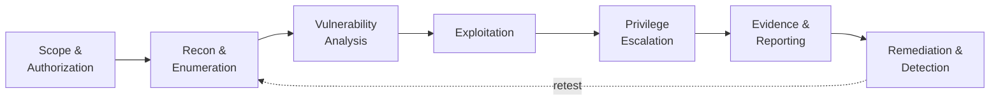

<!-- ═══════════════════════════ HEADER ═══════════════════════════ -->
<div align="center">


<a href="https://github.com/bibeksec">
  
</a>

<br/><br/>

[](https://www.linkedin.com/in/bibek-tamata-2b1808446/)
[](https://bibeksec.github.io/bibeksec.github.io./)
[](https://youtube.com/@BibekSec)

[](https://tryhackme.com/p/bibektamata012)
[](https://app.hackthebox.com/users/3290646)
[](https://portswigger.net/web-security)
[](https://leetcode.com/u/NwLnFoZCvI/)


</div>

---

## 🧬 Identity

```text
$ whoami
bibek_tamata

$ cat profile.txt
role        : Penetration Tester · BIT student · Builder
location    : Nepal 🇳🇵
offense     : Web app testing · enumeration · exploitation in authorized labs
defense     : Log analysis · detection rules · MITRE ATT&CK mapping
languages   : Python · Bash · JavaScript · C++
philosophy  : Understand the fundamentals. Write my own code. Test it. Document it.
rule_one    : Authorization first. Always.
```

I'm **Bibek Tamata**, a penetration tester and BIT student from Nepal. I work on both sides of the fence: I practice offensive techniques in authorized labs, then build tools that **detect** the same attacks. Knowing how an attack works makes better detections, and knowing how detections work makes better attackers *and* better defenders.

<div align="center">

```text
┌───────────────────────────────────────────────────────────┐
│  BIBEKSEC :: OFFENSIVE + DEFENSIVE SECURITY               │
│                                                           │
│   [ ATTACK ] ──▶ [ UNDERSTAND ] ──▶ [ DETECT ] ──▶ [ DEFEND ]   │
│                                                           │
│   Focus       : Pentesting | Python | Detection           │
│   Environment : Linux Mint | Terminal | Security Labs     │
│   Philosophy  : Fundamentals first. Evidence always.      │
└───────────────────────────────────────────────────────────┘
```

</div>

---

## 🎯 How I Work: Pentest Methodology



Every finding I work on ends the same way: **evidence, impact, a fix, and a detection idea.** A vulnerability that can't be explained and defended isn't finished.

---

## 🚀 Featured Projects

### 🛡️ [Sentinel Detect](https://github.com/bibeksec/sentinel-detect): Lightweight Log-Based Threat Detection Engine


A Python tool that reads SSH and web-server logs, spots attack patterns, and prints an alert saying **who attacked, how, how serious it is, and which MITRE ATT&CK technique it matches.** Built from the attacker's point of view: if I can run the attack in a lab, I can write the rule that catches it.

| Rule | Detection | Severity | MITRE ATT&CK |
|:--|:--|:--:|:--|
| `SSH-001` | SSH brute force | High | T1110.001 |
| `SSH-002` | Password spraying | High | T1110.003 |
| `SSH-003` | Successful login after brute force | **Critical** | T1110 / T1078 |
| `WEB-002` | SQL injection indicators | High | T1190 |
| `WEB-003` | Path traversal / sensitive-file access | High | T1190 / T1083 |
| `WEB-006` | Command injection / webshell probes | High | T1190 / T1059 |

<sub>…plus root-login, web-scanner/404-flood, offensive-tool user-agent, and XSS rules (10 detections total).</sub>

**Highlights:** stateful sliding-window detection · event correlation · alert cooldowns · IP allowlisting · custom rules · follow mode for live monitoring · firewall-block suggestions · built-in synthetic attack demo · automated self-tests

```bash
git clone https://github.com/bibeksec/sentinel-detect.git && cd sentinel-detect
python3 sentinel.py --demo      # run the synthetic attack demo
python3 sentinel.py selftest    # run the self-test suite
```

<br/>

### 🔍 [Nepal ScamWatch](https://github.com/bibeksec/nepal-scamwatch-a): Live Scam Reporting Platform


A deployed web app that makes scam awareness more accessible in Nepal. People can submit and search scam reports with evidence uploads, and an admin moderation panel (token-protected) reviews them. Built serverless on **Cloudflare Workers + D1 + R2**, with the security thinking up front: input validation, moderation workflow, abuse prevention, and careful handling of submitted data.

**[→ Live demo](https://nepal-scamwatch.bibektamata012.workers.dev/)** · **[→ Source](https://github.com/bibeksec/nepal-scamwatch-a)**

<br/>

### 🌐 [GOD'S-EYE NEPAL](https://github.com/bibeksec/god-eye): Cyber & Airspace Situational-Awareness Dashboard


A Nepal-focused dashboard on **MapLibre GL** with real 3D terrain and buildings, **live aircraft from the OpenSky Network's public ADS-B data**, animated threat arcs, a province-filtered heatmap, and a **traffic analyzer** (throughput, top talkers, protocol/port mix, spike and **port-scan detection**). Cyber and fleet data is clearly labeled as simulated unless you connect your own feed, and the project states plainly that it does no public vehicle or camera surveillance.

```bash
python3 -m http.server 8000   # then open http://localhost:8000
```

<br/>

### 💻 [BibekSec Portfolio](https://bibeksec.github.io/bibeksec.github.io./)

My hub for write-ups, lab notes, and security experiments.

<br/>

<div align="center">

<a href="https://github.com/bibeksec/sentinel-detect"></a>
<a href="https://github.com/bibeksec/nepal-scamwatch-a"></a>
<a href="https://github.com/bibeksec/god-eye"></a>

</div>

---

## 🏴‍☠️ Offensive Security Focus

| Area | What I practice in authorized labs |
|:--|:--|
| 🌐 **Web application security** | OWASP Top 10 classes: injection, XSS, broken access control, auth flaws, path traversal (PortSwigger Academy + THM) |
| 🔎 **Recon & enumeration** | Port/service discovery with Nmap, directory and content discovery, service fingerprinting |
| 🔧 **Traffic & proxy analysis** | Intercepting and manipulating requests with Burp Suite; protocol analysis with Wireshark |
| 🐧 **Linux & privilege escalation** | Linux internals, permissions, misconfiguration hunting |
| 🐍 **Tooling** | Writing my own Python and Bash utilities instead of only running other people's |
| 🛡️ **Detection mindset** | Turning every technique I learn into a log signature or detection rule (see Sentinel Detect) |

### 📊 Lab Progress

<div align="center">

<a href="https://tryhackme.com/p/bibektamata012"></a>

</div>

<!--
  FILL THESE IN with your real numbers (don't guess, keep it honest):
  | Platform        | Progress                          |
  | TryHackMe       | Rank / rooms completed / streak   |
  | Hack The Box    | Machines owned / challenges       |
  | PortSwigger     | Labs solved (Apprentice/Practitioner/Expert) |
  | LeetCode        | Problems solved                   |
-->

| Platform | Progress |
|:--|:--|
| TryHackMe | [bibektamata012](https://tryhackme.com/p/bibektamata012): *add rank · rooms completed* |
| Hack The Box | [Profile](https://app.hackthebox.com/users/3290646): *add machines owned · challenges* |
| PortSwigger Academy | *add labs solved by level* |
| LeetCode | [Profile](https://leetcode.com/u/NwLnFoZCvI/): *add problems solved* |

---

## 🧰 Technical Arsenal

<div align="center">

| Category | Tools |
|:--|:--|
| **Programming** |    |
| **Systems & Networking** |   |
| **Web & Cloud** |     |
| **Collaboration** |   |


<sub>*My toolkit reflects hands-on practice and ongoing learning, not a claim of mastery in every technology.*</sub>

</div>

---

## 📡 Current Operations

| Status | Mission |
|:--:|:--|
| 🟢 | Practicing web app penetration testing in authorized labs |
| 🟢 | Expanding Sentinel Detect with new detection rules |
| 🟢 | Strengthening Python fundamentals and security tooling |
| 🟡 | Linux administration, privilege escalation, and hardening |
| 🟡 | Networking, traffic analysis, and system security |
| 🟡 | SOC analysis and incident investigation foundations |
| 🟡 | Writing lab write-ups and improving documentation |

<sub>🟢 active practice · 🟡 learning in progress</sub>

---

## 🧠 Learning in Public

A strong security engineer should understand **why** a vulnerability exists, **how** it can be verified safely, **how** it can be detected, and **how** it can be prevented.

```python
class BibekSec:
    mission = "Attack. Understand. Detect. Defend."

    principles = [
        "Understand before automating",
        "Practice before claiming expertise",
        "Test before trusting",
        "Document before publishing",
        "Respect authorization and privacy",
    ]

    def next_step(self):
        return "Learn something. Build something. Prove it."
```

---

## ⚖️ Rules of Engagement

```text
[✔] Only test systems I own or have explicit written permission to test
[✔] Labs and CTFs: TryHackMe, Hack The Box, PortSwigger Academy, my own VMs
[✔] Simulated data unless a real feed is explicitly connected and authorized
[✔] Responsible disclosure if I ever find a real issue
[✘] No unauthorized scanning, no real-world targets, no surveillance of people
```

---

## 🤝 Let's Connect

I'm interested in **open-source security tools**, **Python automation**, **detection engineering**, **responsible OSINT**, and **practical cybersecurity education**. If you're building something useful in security, or want to exchange ideas, reach out:

<div align="center">

[](https://www.linkedin.com/in/bibek-tamata-2b1808446/)
[](https://github.com/bibeksec)
[](https://youtube.com/@BibekSec)

<br/>

**CURIOUS BY NATURE. DISCIPLINED BY PRACTICE.**

`ATTACK` · `UNDERSTAND` · `DETECT` · `DEFEND`

*Building skills. Writing code. Earning trust.*


</div>
